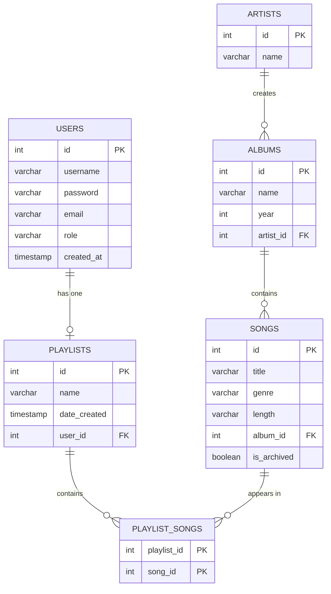

# 🎵 RecordingStudioConsoleApp

A Java console application for managing a recording studio's catalog of **artists, albums, songs, users, and playlists**. Built with **JDBC and MySQL** using a clean **3-tier architecture**, and designed as a progressive teaching project for learning database programming in Java.

---

## Table of Contents

- [Features](#features)
- [Tech Stack](#tech-stack)
- [Architecture](#architecture)
- [Project Structure](#project-structure)
- [Database Design](#database-design)
- [Use Cases](#use-cases)
- [Getting Started](#getting-started)
- [Running the App](#running-the-app)
- [Sample Usage](#sample-usage)
- [Design Decisions](#design-decisions)
- [Learning Path (3-Day Plan)](#learning-path-3-day-plan)
- [Troubleshooting](#troubleshooting)
- [Author](#author)

---

## Features

- **Full CRUD** for Artists, Albums, Songs, and Playlists
- **One playlist per user** (1:1 relationship, enforced by a `UNIQUE` constraint on `playlists.user_id`)
- **Soft delete (archive / restore)** for Songs, so data is never lost by accident
- **Search** by keyword (Songs, Artists, Albums)
- **Login and registration** with BCrypt password hashing
- **Role-based access control**:
  - `USER`: browse the catalog, search songs, and manage their own playlist
  - `ADMIN`: everything a user can do, plus manage Artists, Albums, Songs, and Users
- **Many-to-many playlists**: add and remove songs in a playlist
- **User-friendly console UX**:
  - Descriptive error messages (for example, "No song found with ID 5. Please check the ID and try again.")
  - Press **Enter to keep the current value** when updating
  - **Y/N confirmation** before destructive actions
  - The list is **re-displayed after every create, update, or delete**
- **SQL injection safe**: every query uses `PreparedStatement`

---

## Tech Stack

| Area | Technology |
|---|---|
| Language | Java 17 |
| Database | MySQL 8.x |
| Data access | JDBC (`PreparedStatement`, try-with-resources) |
| Build tool | Maven |
| Password hashing | jBCrypt (`org.mindrot:jbcrypt`) |
| IDE (recommended) | IntelliJ IDEA |

---

## Architecture

The app follows a **3-tier architecture** with a strict one-way flow:

```
┌──────────────────────┐
│  Presentation Tier   │   Views: Scanner input, System.out output
└──────────┬───────────┘
           │ calls
┌──────────▼───────────┐
│     Service Tier     │   Business logic and validation
└──────────┬───────────┘
           │ calls
┌──────────▼───────────┐
│  Data Access Tier    │   Repositories: JDBC and SQL only
└──────────┬───────────┘
           │
        ┌──▼──┐
        │MySQL│
        └─────┘
```

| Tier | Responsibility | Must **not** |
|---|---|---|
| **Presentation** | Show menus, read input, display results and messages | Contain SQL or business rules |
| **Service** | Validate data, enforce rules, coordinate repositories | Read input or print UI messages |
| **Repository** | Run SQL through JDBC, map rows to objects | Print messages or validate business rules |

The **model** package (plain Java objects) and **config** package (database connection) are shared by all tiers.

**Key principles applied:** Separation of Concerns, DRY, composition over inheritance (constructor injection), and programming to interfaces.

---

## Project Structure

```
RecordingStudioConsoleApp
├── pom.xml
├── database
│   └── schema.sql
└── src/main/java/com/joysistvi/recordingapp
    ├── App.java                      # Entry point: wires the tiers together
    ├── config
    │   └── DbConnection.java         # Database connection settings
    ├── model
    │   ├── Artist.java
    │   ├── Album.java
    │   ├── Song.java
    │   ├── Playlist.java
    │   └── User.java
    ├── presentation                  # Tier 1
    │   ├── ArtistView.java
    │   ├── AlbumView.java
    │   ├── SongView.java
    │   ├── PlaylistView.java
    │   └── UserView.java
    ├── service                       # Tier 2
    │   ├── ArtistService.java        (interface)
    │   ├── ArtistServiceImpl.java
    │   └── ...                       (same pattern for each entity)
    └── repository                    # Tier 3
        ├── ArtistRepository.java     (interface)
        ├── ArtistRepositoryImpl.java
        └── ...                       (same pattern for each entity)
```

---

## Database Design

**Database name:** `recording_studio`
**Schema file:** [`database/recording_studio_db.sql`](database/recording_studio_db.sql) (tables and sample data)


### Entity relationships

- An **Artist** creates many **Albums**
- An **Album** contains many **Songs**
- A **User** has one **Playlist** (1:1)
- A **Playlist** contains many **Songs** (many-to-many through `playlist_songs`)



### Tables

| Table | Columns |
|---|---|
| `artists` | `id`, `name` |
| `albums` | `id`, `name`, `year`, `artist_id` (FK) |
| `songs` | `id`, `title`, `genre`, `length` (text, e.g. `3:45`), `album_id` (FK), `is_archived` (default `FALSE`) |
| `users` | `id`, `username` (unique), `password` (BCrypt hash), `email` (unique), `role` (`USER` or `ADMIN`, default `USER`), `created_at` |
| `playlists` | `id`, `name`, `date_created`, `user_id` (FK, **UNIQUE**, which enforces the 1:1 relationship with `users`) |
| `playlist_songs` | `playlist_id` (FK), `song_id` (FK), composite primary key, `ON DELETE CASCADE` |

---

## Use Cases

**Both actors:** Login

**User:**
- Register Account
- Browse Artists, Albums, and Songs
- Search Songs
- Manage Own Playlist
- Add / Remove Songs in Playlist

**Admin:**
- Manage Artists
- Manage Albums
- Manage Songs (including archive and restore)
- Manage Users

> Self-registration always creates an account with role `USER`. Admin accounts are created manually in the database (see below).

---

## Getting Started

### Prerequisites

- **JDK 17** or newer
- **XAMPP** (MySQL / MariaDB) or MySQL 8.x running on port `3306`
- **Maven 3.8+** (or use the one bundled with IntelliJ IDEA)
- Git

### 1. Clone the repository

```bash
git clone https://github.com/Cedy7/b426-csp1-manito-cedrick-.git
cd RecordingStudioConsoleApp
```

### 2. Create the database

**Option A: phpMyAdmin**
1. Start **Apache** and **MySQL** in XAMPP.
2. Open `http://localhost/phpmyadmin`, then go to **Import**.
3. Choose `database/recording_studio_db.sql` and click **Import**.

**Option B: Terminal**
Run the script in MySQL Workbench or the MySQL CLI:

```bash
mysql -u root -p < database/recording_studio_db.sql
```

This creates the `recording_studio` database, all tables, and some sample artists, albums, and songs.

### 3. Configure the connection

Open `src/main/java/com/joysistvi/recordingapp/config/DbConnection.java` and update the credentials:

```java
private static final String URL = "jdbc:mysql://localhost:3306/recording_studio";
private static final String USER = "root";
private static final String PASSWORD = "";
```

> ⚠️ Never commit real passwords to GitHub. Keep your local credentials out of version control, or load them from environment variables.

### 4. Create an admin account (optional)

1. Run the app and register a normal account.
2. Promote it in MySQL:

```sql
UPDATE users SET role = 'ADMIN' WHERE username = 'your_username';
```

---

## Running the App

### Option A: From IntelliJ IDEA

1. Open the project and let Maven import the dependencies.
2. Run `App.java`.
3. (Optional) To enable screen clearing, turn on **Run Configuration → Modify options → Emulate terminal in output console**.

---

## Sample Usage

```
Admin view while logging in with an `ADMIN` account:

```
```
===== Welcome to Recording Studio =====
1. Login
2. Register
0. Exit
Choose: 1

=== LOGIN ===
Enter username: yourname
Enter password: yourname12345
Login successful! Welcome, yourname (ADMIN).

Welcome, yourname (ADMIN)!

=== ADMIN DASHBOARD ===
1. Song Management
2. Artist Management
3. Album Management
4. Users Management
0. Back
Choice: 1

=== SONG MANAGEMENT ===
1. View All Active Songs
2. Create Song
3. Update Song
4. Search Songs
5. Archive Song
6. Restore Song
7. Delete Song
0. Back
Choose an option: 1

----- Active Songs -----
+-------+------------------------+-----------------+----------+----------------------+
| ID    | Title                  | Genre           | Length   | Album                |
+-------+------------------------+-----------------+----------+----------------------+
| 1     | yourfavoritesong1      | favoritegenre1  | 4:00     | yourfavoritealbum1   |
| 2     | yourfavoritesong2      | favoritegenre2  | 5:02     | yourfavoritealbum2   |
| 3     | yourfavoritesong3      | favoritegenre3  | 7:29     | yourfavoritealbum3   |
| 4     | yourfavoritesong4      | favoritegenre4  | 4:08     | yourfavoritealbum4   |
| 5     | yourfavoritesong4      | favoritegenre5  | 4:20     | yourfavoritealbum5   |
+-------+------------------------+-----------------+----------+----------------------+


```
User view while logging in with an `USER` account:

```

=== RECORDING STUDIO APP ===
1. Login
2. Register Account
0. Exit
Choose an option: 1

=== LOGIN ===
Enter username: yourname
Enter password: yourname12345
Login successful! Welcome, yourname (USER).

Welcome, yourname (USER)!

=== USER DASHBOARD ===
1. Browse Artists, Albums, and Songs
2. Search Songs
3. Manage Playlist
4. Add / Remove Songs in Playlist
0. Logout
Choice: 1

=== BROWSE CATALOG ===
1. View Artists
2. View Albums
3. View Songs
0. Back
Choice: 3

----- Active Songs -----
+-------+------------------------+-----------------+----------+----------------------+
| ID    | Title                  | Genre           | Length   | Album                |
+-------+------------------------+-----------------+----------+----------------------+
| 1     | yourfavoritesong1      | favoritegenre1  | 4:00     | yourfavoritealbum1   |
| 2     | yourfavoritesong2      | favoritegenre2  | 5:02     | yourfavoritealbum2   |
| 3     | yourfavoritesong3      | favoritegenre3  | 7:29     | yourfavoritealbum3   |
| 4     | yourfavoritesong4      | favoritegenre4  | 4:08     | yourfavoritealbum4   |
| 5     | yourfavoritesong4      | favoritegenre5  | 4:20     | yourfavoritealbum5   |
+-------+------------------------+-----------------+----------+----------------------+


```

---

## Design Decisions

- **Role stored as `VARCHAR`** (`USER` or `ADMIN`) instead of a boolean or enum to keep the code simple and beginner-friendly.
- **Soft delete for songs** (`is_archived`) so playlists and history are not broken by a delete.
- **BCrypt for passwords**: plain-text passwords are never stored.
- **Service owns validation, View owns messages**: services stay silent and return results, so the user never sees the same error twice.
- **Repositories never print success messages**: they only log SQL errors.
- **Interfaces for services and repositories** so implementations can be swapped (for example, for testing).
- **Song `length` stored as text** (for example, `3:45`) for simplicity.

---

## Learning Path (3-Day Plan)

| Day | Topic | Activity |
|---|---|---|
| **1** | JDBC fundamentals: everything inside one `Main` class (connect, CRUD with `PreparedStatement`) | Artists, Albums, and Users CRUD with guard clauses and BCrypt |
| **2** | 3-tier architecture: refactor `Main` into View, Service, and Repository tiers with constructor injection | Refactor Artist, Album, and User; add the Song module and `handleMenu()` in every view |
| **3** | Complete the application: Playlists, the `playlist_songs` junction table, login, and role-based dashboards | Integrate all modules, polish tables and screen clearing, add the SQL file and README |

---

## Troubleshooting

| Problem | Fix |
|---|---|
| `No suitable driver found for jdbc:mysql://...` | Run the shaded jar (`java -jar target/...jar`), not `mvn exec:java` |
| `Access denied for user 'root'` | Check the `USER` and `PASSWORD` values in `DbConnection.java` |
| `Unknown database 'recording_studio'` | Run `database/schema.sql` first |
| `Communications link failure` | Make sure the MySQL server is running on port 3306 |
| Screen does not clear in IntelliJ | Enable **Emulate terminal in output console** in the Run Configuration |
| `mvn` is not recognized (Windows) | Add Maven's `bin` folder to the `PATH` environment variable and reopen the terminal |

---

## Author

**Cedrick Manito**
TESDA TWSP Programming (Java) NC III, Joysis Tech Voc Inc.


## Acknowledgements

- Course instructor:**Jareth Ronquillo**
Full Stack Web Developer and Java Instructor, Joysis Tech Voc Inc.